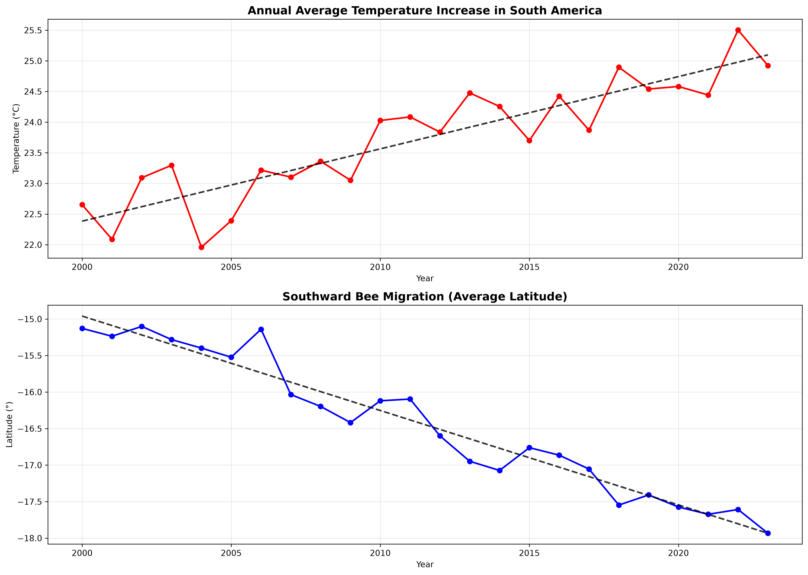
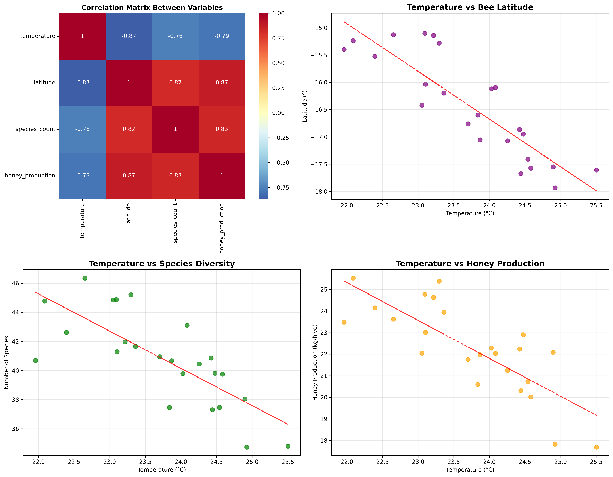
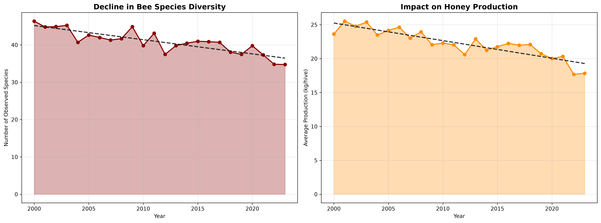
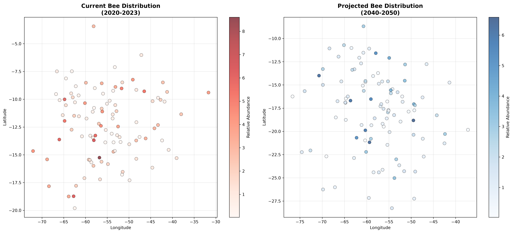
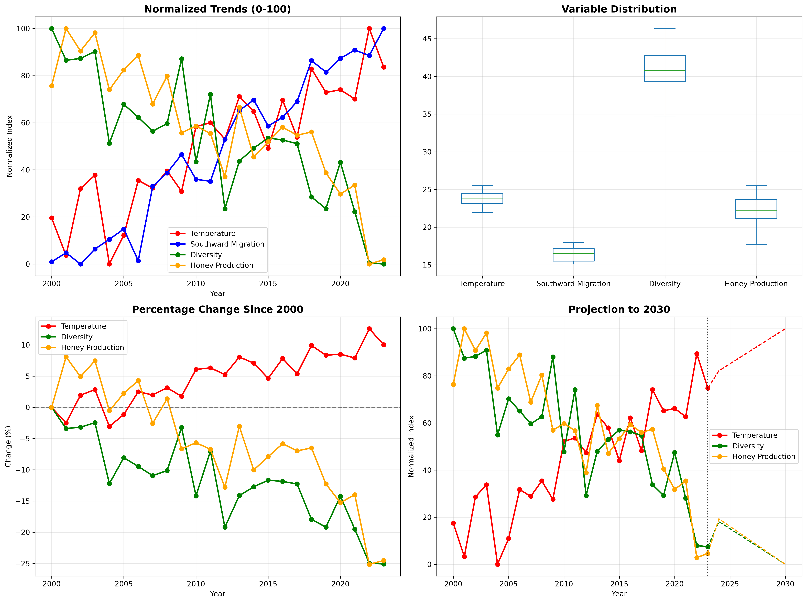
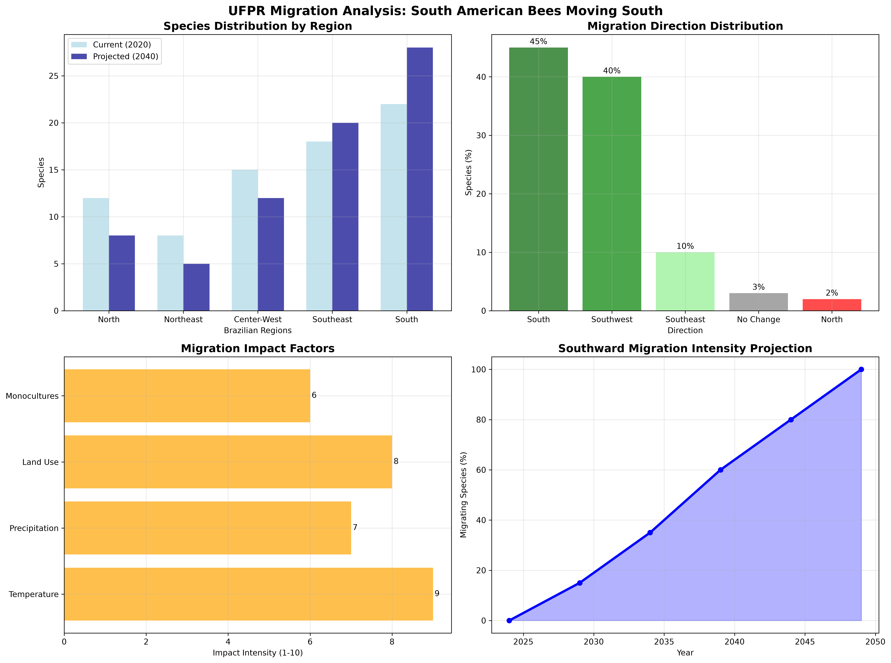
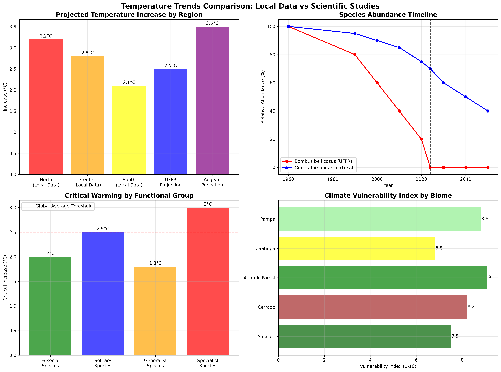
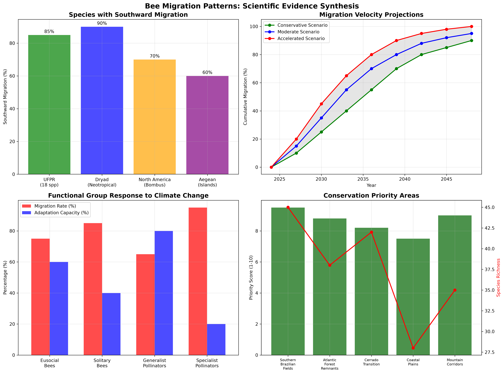

# Bee Migration Analysis

[](https://github.com/digomes87/Bees/actions/workflows/ci.yml)
[](https://www.python.org/downloads/)
[](https://digomes87.github.io/Bees/)

A Python package and a browser dashboard for studying how climate relates to
bee populations in South America: regional trends, correlations, and models
that forecast bee measurements from climate.

**[Open the dashboard](https://digomes87.github.io/Bees/)** — it runs this
package in your browser, nothing to install.

## What the data is

Read this before quoting any number from the project.

| Data | Where it comes from | What it supports |
|------|--------------------|------------------|
| Regional observations (temperature, precipitation, bee abundance, diversity, honey) | **Simulated** from assumed warming and decline rates | Demonstrating the method. No scientific conclusion. |
| Observed temperature | Open-Meteo archive (ERA5 reanalysis), fetched live | Real warming at five points, one per Brazilian region |
| Bee occurrence records | GBIF, family Apidae, fetched live | Where bees were *recorded*, which also reflects where people looked |
| Figures in the literature charts | Entered by hand as a reading of the cited studies | Illustration only; not extracted from the studies' datasets |

The question in the project's name, whether bees are moving south, is **not
answered** by this repository. The cited literature projects southward range
shifts for south-eastern South America. The live field chapter, loaded on
2026-10-11, showed +0.10 °C per decade at the five region centres and a mean
latitude of GBIF records that barely moved (−0.1° per decade over 136,300
records). Record locations follow observers as much as bees, so that neither
confirms nor rules out a shift.

## Quick start

```bash
git clone https://github.com/digomes87/Bees.git
cd Bees
pip install -e .

bee-migration all        # analysis, model comparison and charts
```

Requires Python 3.11 or newer.

## Usage

### Command line

```bash
bee-migration analyze              # trends, correlations, summary report
bee-migration predict              # train and compare the models
bee-migration charts               # render the charts into images/
bee-migration all                  # everything above

# Options shared by every command
bee-migration analyze --data my_observations.csv   # use your own data
bee-migration analyze --root /tmp/run --seed 7     # output folder and random seed
```

A CSV passed with `--data` needs one row per region and year, with the columns
`year`, `region`, `latitude`, `longitude`, `temperature`, `precipitation`,
`bee_abundance`, `species_diversity` and `honey_production`. Years must be
consecutive within each region. Without `--data` the commands run on simulated
observations (2000–2023, five Brazilian regions).

| Command | Writes |
|---------|--------|
| `analyze` | `results/analysis_summary_report.txt`, `results/correlation_analysis_correlation_matrix.csv`, `data/processed/bee_climate_processed.csv` |
| `predict` | `results/ml_predictions_report.txt`, `results/model_metrics.csv`, `results/feature_importance.csv`, `results/models/*.pkl` |
| `charts` | `images/*.png`, `data/bee_climate_data.csv`, `data/bee_geographic_data.csv` |

### Python

```python
from bee_migration.analysis.correlation import Correlations
from bee_migration.analysis.temporal import TemporalPatterns
from bee_migration.climate.period import DEFAULT_PERIOD
from bee_migration.climate.region import BRAZILIAN_REGIONS
from bee_migration.climate.simulation import ClimateSimulation
from bee_migration.prediction.training import MigrationPredictor

observations = ClimateSimulation(BRAZILIAN_REGIONS, DEFAULT_PERIOD).observations()

trends = TemporalPatterns(observations).trends()
pairs = Correlations(observations).notable_pairs()

leaderboard = MigrationPredictor().train(observations)
best = leaderboard.best()
```

`notebooks/bee_migration_tutorial.ipynb` walks through the same steps.

### In the browser

The dashboard in `docs/` loads this package into the page with
[Pyodide](https://pyodide.org/). Choose a seed, the number of held-out years and
the measurement to forecast; the study is computed on your machine. A separate
chapter fetches the field data described above.

```bash
make site    # builds the package into docs/package and serves http://127.0.0.1:8000
```

Pushes to `main` publish the site through the `Pages` workflow.

## How it works

1. **Observations** — yearly climate and bee measurements per region, validated
   on load, with anomalies, a climate stress index and a bee health index derived
   from them.
2. **Analysis** — linear trend per region, sharp bends in a series, correlations
   (overall, per region, and with bee abundance lagged by one to three years),
   and regional summaries.
3. **Prediction** — four regressors (linear, random forest, gradient boosting,
   SVR) learn a bee measurement from climate and from the previous year's value.
   They are tuned with time-ordered cross-validation and scored on the most
   recent years, which they never see while training.
4. **Outputs** — plain-text reports, CSV tables, charts, or JSON for the
   dashboard.

```
Bees/
├── src/bee_migration/
│   ├── climate/       # observations and simulated datasets
│   ├── analysis/      # temporal, correlation and geographic patterns
│   ├── prediction/    # features, model catalog, training, scores
│   ├── sources/       # GBIF and Open-Meteo answers into tables
│   ├── evidence/      # figures summarised from the cited studies
│   ├── charts/        # chart panels and gallery
│   ├── reports/       # plain-text reports
│   ├── web/           # studies as JSON for the dashboard
│   └── cli.py         # the bee-migration command
├── docs/              # dashboard (HTML, CSS, JavaScript)
├── tests/             # Python tests; tests/web holds the site's tests
├── notebooks/         # tutorial
├── data/ results/ images/   # outputs of the commands above
└── pyproject.toml
```

## Results on the simulated observations

These describe the simulation's assumptions coming back out of the pipeline.
They are useful for checking the method, not for learning about bees.

| Model | R² on held-out years | RMSE |
|-------|---------------------|------|
| Linear Regression | 0.81 | 5.2 |
| SVR | 0.78 | 5.6 |
| Random Forest | 0.53 | 8.0 |
| Gradient Boosting | 0.48 | 8.5 |

Forecasting bee abundance, four most recent years held out, seed 42. Full
figures are in `results/ml_predictions_report.txt` and
`results/model_metrics.csv`.

## Charts

Drawn from simulated continent-wide series:







Drawn from figures entered by hand as a reading of the literature:





## Literature behind the project

The project was motivated by published work on climate-driven range shifts in
bees. A synthesis in Portuguese is in `results/scientific_papers_synthesis.md`.

- UFPR — climate change pushing South American bees southward (18 species,
  south-eastern South America, projections to 2050)
- Dryad dataset — climate-induced range shifts in the south-eastern Neotropics
- Ecology Letters — warming temperatures restructuring bumble bee communities in
  North America
- PMC — global warming and the small hive beetle, a honey bee pest
- PMC — climate change impacts on island bees in the Aegean Archipelago

## Development

```bash
pip install -e ".[dev]"

pytest                               # Python tests with coverage
ruff check src tests                 # linting
ruff format src tests                # formatting
node --test "tests/web/*.test.mjs"   # dashboard utilities
```

The project follows Git Flow: work branches from `develop`, pull requests into
`develop`, releases from `develop` into `main`. The `CI` workflow must pass
before anything is merged. See [CONTRIBUTING.md](CONTRIBUTING.md).

Docker is optional:

```bash
docker compose run --rm analysis all   # run the pipeline in a container
docker compose up site                 # serve the dashboard on http://127.0.0.1:8000
```

## Roadmap

Done:

- Tested package and command line
- Dashboard that runs the package in the browser
- Live field data from GBIF and Open-Meteo

Open:

- Field data from the command line, not only in the dashboard
- Cross-validation folds cut on year boundaries for any table shape
- REST API for predictions, if something needs to consume it
- Occurrence data corrected for sampling effort, so record locations can say
  something about ranges

## Acknowledgments

Data: [GBIF](https://www.gbif.org/) and [Open-Meteo](https://open-meteo.com/)
(ERA5 reanalysis from Copernicus/ECMWF). Studies: UFPR, Dryad, Ecology Letters
and PMC, as listed above.

## Author

Diego Gomes — [@digomes87](https://github.com/digomes87).
Questions and bugs: [issues](https://github.com/digomes87/Bees/issues).
